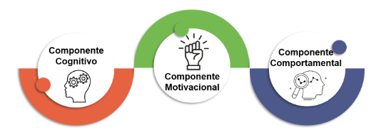
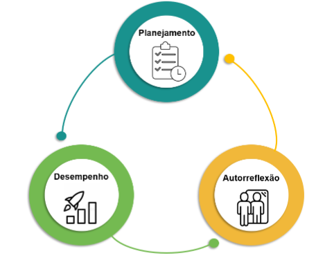
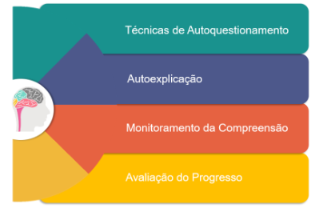

# AUTORREGULAÇÃO DA APRENDIZAGEM

## Tornando-se um aprendiz ativo

A **autorregulação** representa a capacidade de conduzir conscientemente o próprio processo de aprendizagem, planejando, monitorando e avaliando continuamente cada etapa do desenvolvimento formativo.

Quando falamos em autorregulação, tratamos da metacognição em ação — a habilidade de conduzir nossa própria aprendizagem. Significa definir objetivos, monitorar o percurso e ajustar a rota sempre que necessário.

Podemos imaginar esse processo como pilotar nosso próprio voo formativo: não é o acaso que determina o caminho, mas nossa capacidade de planejar, observar e refletir sobre cada passo da trajetória de aprendizagem.

## Componentes da autorregulação

Compreender a autorregulação da aprendizagem implica reconhecer que ela se apoia em múltiplas dimensões. Não se limita ao uso de estratégias cognitivas, mas envolve também a motivação que nos move e as ações que organizam nosso processo de aprender.

Assim, a autorregulação configura-se como um movimento integrado, no qual pensamos, sentimos e agimos de forma consciente em direção às metas que construímos coletivamente.

Figura 5: Componentes da Autorregulação

| Componente cognitivo | Componente motivacional | Componente comportamental |
| -- | -- | -- |
| Inclui as estratégias utilizadas para aprender — como resumir, organizar, elaborar conexões e memorizar. Contudo, não basta conhecer as técnicas; é necessário saber quando e como aplicá-las de modo intencional. | A autorregulação depende fortemente da motivação. São crenças, valores e emoções que impulsionam (ou limitam) o processo de aprender. A autoeficácia — acreditar que somos capazes — fortalece o envolvimento, assim como reconhecer o valor e o sentido da atividade amplia o empenho e a persistência diante dos desafios. | Refere-se às ações concretas que criamos para favorecer a aprendizagem: organizar o ambiente, gerenciar o tempo, buscar apoio e manter o foco. |
| Exemplo prático:
um(a) professor(a), ao estudar um novo autor, opta por elaborar um mapa mental em vez de apenas sublinhar o texto, percebendo que assim assimila melhor as ideias principais. | Exemplo prático:
uma professora decide aprofundar-se em metodologias ativas. Mesmo diante das dificuldades, mantém o compromisso por acreditar na relevância do tema e em nossa própria capacidade de aprender. | Exemplo prático:
um(a) docente que desliga o celular para estudar, define um cronograma de leituras e reserva momentos de troca com colegas está colocando a autorregulação em prática. |

> O Ciclo de Zimmerman (2002)
> Barry Zimmerman, um dos principais estudiosos da autorregulação, demonstrou que esse processo não ocorre de forma linear, mas sim em ciclo contínuo. Por isso, a autorregulação é dinâmica e evolutiva: estamos sempre ajustando, testando e aprimorando nossas estratégias de aprendizagem. Esse ciclo é composto por três fases principais, que se repetem e se renovam continuamente.

Figura 6: Três fases do Ciclo de Zimmerman

Durante a fase de planejamento (ou previsão), é o momento de pensar antes de agir. Nessa etapa, analisamos a tarefa de aprendizagem, refletimos sobre o que ela exige, quais objetivos queremos alcançar e em que condições iremos trabalhar. Na fase de desempenho (ou execução e controle), colocamos o plano em prática. O foco está em observar o próprio processo de aprendizagem, manter a atenção e ajustar as estratégias sempre que necessário. Por fim, na fase de autorreflexão (ou avaliação), que ocorre após a conclusão da tarefa, analisamos os resultados obtidos. Esse olhar final permite redefinir estratégias e aperfeiçoar o ciclo em futuras experiências formativas.

O modelo de Zimmerman mostra que a autorregulação é um ciclo permanente, e não um evento isolado. Cada vez que planejamos, atuamos e refletimos, ampliamos nossa consciência metacognitiva e fortalecemos nossa autonomia profissional.

## Aplicando as fases do ciclo de Zimmerman ao planejamento:

| **Planejamento** (fase de previsão): | **Desempenho** (fase de execução e controle): | **Autorreflexão** (fase de avaliação): |
| -- | -- | -- |
|ao preparar uma aula, definimos os objetivos, escolhemos as metodologias mais adequadas ao grupo, selecionamos os materiais e organizamos o tempo disponível. Nesse momento, refletimos: estamos prontos(as) para conduzir esta atividade? O que desejamos que nossos estudantes aprendam? Quais competências pretendemos desenvolver? | em sala de aula, observamos os sinais de atenção ou dispersão e ajustamos ritmo, exemplos e estratégias para manter o engajamento. Inserimos perguntas, situações cotidianas ou desafios que favorecem a participação ativa da turma. | após a aula, analisamos os resultados e nos perguntamos: alcançamos nossos objetivos? O que funcionou bem? Onde ainda houve dificuldades? O que podemos aprimorar na próxima experiência? |

## Estratégias metacognitivas pessoais: ferramentas para o autoconhecimento cognitivo

Desenvolver a metacognição vai além de compreender teorias. O verdadeiro desafio está em aplicar estratégias que nos ajudem a reconhecer como aprendemos e pensamos. Essas práticas funcionam como espelhos de nossa aprendizagem, permitindo identificar potencialidades, reconhecer fragilidades e realizar escolhas mais conscientes. Assim, fortalecemos nossa capacidade de aprender a aprender, de modo autônomo, colaborativo e contínuo.

Figura 7: Estratégias metacognitivas pessoais para o autoconhecimento cognitivo.

Uma das primeiras estratégias é o autoquestionamento. Antes de iniciar uma tarefa, perguntamos a nós mesmos(as): o que já sabemos sobre este assunto? O que precisamos alcançar com esta atividade?

Durante o processo, novas perguntas orientam nosso percurso: estamos realmente compreendendo o que lemos? Esta estratégia está funcionando ou devemos experimentar outra?

Ao final, refletimos sobre o caminho percorrido: atingimos nossos objetivos? O que poderíamos fazer diferente na próxima vez?

Outra estratégia poderosa é a auto explicação. Ao explicarmos para nós mesmos(as) um conceito — em voz alta ou por escrito — percebemos se de fato o compreendemos. Muitas vezes, a clareza surge quando colocamos o conhecimento em nossas próprias palavras.

O monitoramento da compreensão também é essencial. Em vez de avançar mecanicamente, paramos para verificar: conseguimos resumir este trecho em uma frase? Sabemos dar um exemplo prático desse conceito?

Por fim, há a avaliação do progresso, que consiste em acompanhar nossa evolução ao longo do tempo. Comparar o que sabíamos antes com o que somos capazes de fazer agora nos dá um senso concreto de avanço. Esse exercício fortalece a motivação e revela quais caminhos foram mais eficazes.

---

# Resumo das estratégias metacognitivas pessoais:

 * Quadro 1: Resumo das Estratégias Metacognitivas Pessoais

| **Estratégias Metacognitivas** | **O que é**: | **Como aplicar**: | **Perguntas-chave**: |
| -- | -- | -- | -- |
|**Autoquestionamento** | Fazer perguntas a si mesmo antes, durante e depois da tarefa. | Defina objetivos, monitore sua compreensão e avalie resultados. | Antes: O que já sei? / Durante: Estou entendendo? / Depois: Alcancei o que queria? |
|**Auto explicação** | Explicar em voz alta ou por escrito o conteúdo estudado. | Reescreva com suas próprias palavras, ensine a alguém ou grave um áudio explicando. | Consigo explicar esse conceito sem olhar minhas anotações? |
|**Monitoramento da Compreensão** | Verificar periodicamente se está realmente entendendo. | Resuma trechos, crie exemplos, aplique em situações práticas. | Consigo resumir esse tópico em uma frase? / Sei dar um exemplo? |
| **Avaliação do Progresso** | Acompanhar avanços ao longo do tempo.| Compare desempenho anterior e atual, refaça exercícios, registre conquistas. | O que melhorei desde o início? / O que ainda preciso reforçar? |
