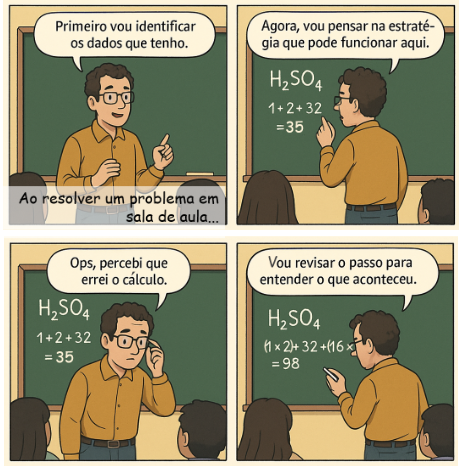
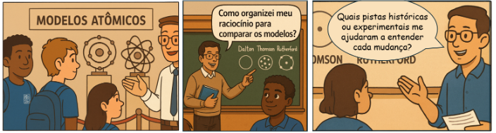

# Ferramentas práticas para a reflexão: 
## materializando a metacognição

> Refletir sobre a aprendizagem é essencial, mas só produz transformação real quando ganha forma concreta. Por isso, precisamos de ferramentas que nos ajudem a materializar o pensamento, registrando, organizando e revisitando nossas experiências.

Esses instrumentos atuam como espelhos externos, capazes de revelar o que muitas vezes passaria despercebido e de tornar mais nítido o nosso percurso formativo, permitindo que vejamos com clareza o caminho que estamos construindo juntos(as).

### Ferramentas para reflexão de aprendizagem

A seguir, destacamos algumas ferramentas baseadas em dois olhares: como podemos usar em nossa própria aprendizagem e ainda aplicar com nossos alunos em sala de aula.

Quadro 2: Ferramentas práticas para reflexão da metacognição

|Ferramentas | Em nossa aprendizagem: | Com nossos alunos:|
| -- | -- | -- |
|Diários de Bordo ou Diários de Aprendizagem |O diário é um espaço de diálogo individual. Ao registrar nossas experiências, dúvidas, estratégias usadas e resultados alcançados, construímos um retrato do nosso percurso formativo. Escrever sobre frustrações, conquistas e aprendizados nos ajuda a perceber padrões e a identificar pontos que precisam de atenção. | Propor que os estudantes mantenham um diário de aprendizagem, no qual registram o que compreenderam na aula, quais dúvidas ficaram e como se sentiram durante a atividade. Esses registros revelam não só o que aprenderam, mas também como aprenderam.|
| Mapas Conceituais ou Mentais |Ao organizar visualmente ideias, tornamos explícitas as conexões entre conceitos. Esse recurso ajuda a enxergar o que já domina e o que ainda precisa aprofundar. Criar um mapa conceitual após estudar um novo tema funciona como uma forma de consolidar e revisar o conhecimento. | Pedir que os estudantes elaborem mapas conceituais ao final de uma aula ou unidade. Isso permite verificar como estruturaram o conteúdo e se conseguem relacionar os conceitos principais. Além disso, torna-se um recurso de revisão visual para provas ou projetos. |
| Portfólios Reflexivos (digitais ou físicos) | O portfólio reúne evidências concretas da nossa trajetória: planos de aula, registros de formações, projetos aplicados. Porém o mais importante é refletir sobre cada item: “Por que este material é significativo para mim? O que ele mostra sobre minha evolução como docente?”. | Propor que construam um portfólio com atividades, produções e reflexões ao longo do bimestre ou semestre. Esse processo valoriza não apenas o produto, mas todo o caminho percorrido, mostrando crescimento e desenvolvimento. | 
| Checklists de Autoavaliação | Um checklist funciona como guia prático para nos autoavaliar. Antes de iniciar uma atividade, podemos checar: “Defini objetivos claros? Escolhi estratégias adequadas? Avaliei os resultados ao final?”. Essa verificação ajuda a manter o foco e a refletir sobre a qualidade do nosso trabalho. | Elaborar checklists simples para que os estudantes revisem suas próprias produções. Perguntas como “Revisei meu texto? Conferi os cálculos? Expliquei meu raciocínio?” estimulam a autonomia e o senso de responsabilidade sobre o próprio aprendizado.|
| Quadros K-W-L (Know – Want to Know – Learned) |Antes de começar um estudo, registrar o que já sabemos sobre o tema, o que desejamos aprender e, ao final, o que realmente aprendemos. | Pedir que construam esse quadro no início e no fim de uma sequência de aulas. Ajuda a tornar visíveis os avanços e lacunas. |
| Roteiros de Auto explicação | Elaborar perguntas-guias para nos autoexplicar enquanto estuda (ex.: “Por que este conceito é importante?”). |  Entregar um conjunto de perguntas para que eles expliquem suas respostas e raciocínios, favorecendo a consciência sobre o processo de resolução. |
| Rubricas de Autoavaliação | Criar critérios claros (por exemplo: clareza, profundidade, organização) para avaliar o próprio trabalho. | Fornecer rubricas simples para que avaliem seus projetos ou produções antes da entrega. Isso ajuda a refletir sobre qualidade e pontos a melhorar.|
| Registros em Áudio ou Vídeo | Gravar áudios curtos refletindo sobre o que aprendemos em cada estudo. Depois, escutar novamente e perceber sua evolução. | Incentivar a gravar reflexões orais rápidas sobre o que aprenderam na aula. Esse exercício pode revelar percepções que nem sempre aparecem no papel.|
| Tabelas de Comparação | Organizar conceitos em colunas comparativas (ex.: metodologias tradicionais × metodologias ativas), destacando semelhanças, diferenças e implicações. | Pedir que comparem teorias, eventos históricos ou fenômenos científicos. Isso estima análise crítica e organização do pensamento. |
| Journaling de Perguntas | Manter um caderno ou arquivo digital apenas para perguntas que surgem durante os estudos. Revisite essas questões depois para verificar o que já conseguiu responder. | Propor que registrem perguntas ao longo das aulas e escolham algumas para compartilhar no final. |

Essas ferramentas fortalecem a metacognição porque tornam o processo de aprender mais visível e consciente. Quando as utilizamos em nossa própria formação, desenvolvemos autonomia e autorreflexão. Ao levarmos essas experiências para a sala de aula, possibilitamos que nossos estudantes assumam o protagonismo de sua própria aprendizagem, reconhecendo-se como sujeitos ativos no processo de aprender.

---

### O professor como modelo e facilitador

Promover a metacognição nos estudantes é um dos maiores legados da docência. Mais do que ensinar conteúdos, ensinamos a pensar sobre como se aprende. Nesse movimento, somos o primeiro exemplo, pois os alunos aprendem observando nossas atitudes e estratégias.

Quando revelamos nosso próprio raciocínio — planejando em voz alta, revendo decisões ou refletindo sobre um erro —, mostramos que aprender é um processo contínuo, feito de tentativas, ajustes e melhorias. Essa transparência ajuda a compreender que não existe aprendizagem perfeita, mas sim um percurso consciente, intencional e em constante construção coletiva.

---

Essa fala simples modela como refletir sobre o próprio pensamento. mostrando, de forma concreta, como o raciocínio pode ser exposto, analisado e aprimorado. Ao tornar visível o processo mental, abrimos caminho para que todos aprendam a pensar sobre o próprio pensar, fortalecendo a metacognição como prática cotidiana.

### Criando oportunidades de reflexão
Além de modelar o pensamento reflexivo, podemos estimular a metacognição dos estudantes por meio de atividades que os levem a parar, pensar e analisar nossos próprios processos de aprendizagem.

As perguntas metacognitivas são excelentes pontos de partida: “Como você chegou a essa resposta?”, “Que estratégia utilizou para resolver o problema?”, “O que faria diferente da próxima vez?”

Essas questões não se limitam à verificação de resultados; elas convidam à consciência sobre o percurso, permitindo que cada estudante reconheça seus pontos fortes e identifique aspectos a aprimorar.

### Modelagem do pensamento docente
Ao explicitar nossos próprios processos de raciocínio, mostramos como a reflexão acontece na prática. Podemos dizer, por exemplo: “Não compreendi isso de primeira, então vou reler este trecho e fazer um mapa mental” ou “Para resolver esta questão, primeiro vou pensar nos passos que preciso seguir...”

Essas falas modelam o pensamento metacognitivo em ação, demonstrando que refletir, revisar e ajustar estratégias faz parte natural da aprendizagem — tanto para quem ensina quanto para quem aprende.

### Promoção da metacognição nos alunos:
Perguntas metacognitivas: incentivamos os(as) estudantes a se perguntarem “Como cheguei a essa resposta?”, “O que fiz quando encontrei uma dificuldade?”, “Qual parte da leitura foi mais desafiadora e por quê?” ou “Que estratégia utilizei para memorizar este conteúdo?”. Essas perguntas ampliam a consciência sobre o próprio modo de aprender.
Atividades reflexivas: propomos tarefas em que os(as) estudantes explicam seus raciocínios, comparam estratégias de resolução ou avaliam o próprio desempenho em projetos e atividades. Assim, o foco desloca-se do acerto isolado para o processo de construção do conhecimento.
Diários de aprendizagem: incentivamos a manutenção de registros reflexivos, nos quais os(as) estudantes anotam aprendizados, dúvidas, estratégias e percepções sobre as aulas, desenvolvendo uma memória formativa do próprio percurso.
Feedback estratégico: oferecemos retornos que valorizam o processo, não apenas o resultado. Podemos dizer, por exemplo: “Sua resolução está correta, e notei que você organizou bem suas ideias antes de começar. Essa estratégia ajudou no seu 
raciocínio?” Esse tipo de feedback promove autoconsciência e regulação das estratégias de aprendizagem.

---

- Estudos de caso
Trabalhar com estudos de caso é uma maneira prática e eficaz de estimular a metacognição, pois coloca os estudantes em situações que exigem explicar seus processos de pensamento, e não apenas apresentar respostas prontas. Ao analisar, discutir e justificar decisões, os estudantes tornam visíveis suas formas de raciocinar, aprendendo a avaliar estratégias, reconhecer erros e ajustar caminhos.

A seguir, apresentamos exemplos adaptados para diferentes objetos do conhecimento, que podem ser utilizados em sala de aula para favorecer a reflexão e o desenvolvimento da autonomia intelectual.

**Objeto de conhecimento**: modelos atômicos:
* **Situação**: Em um museu de ciência, há uma exposição que apresenta a evolução dos modelos atômicos: o de Dalton, o de Thomson, o de Rutherford e o de Bohr. Um grupo de estudantes discute qual deles seria o “verdadeiro modelo do átomo.

* **Desafio para os alunos**: Explicar por que cada modelo foi importante em seu tempo e quais limitações levaram ao surgimento do modelo seguinte.

Perguntas metacognitivas:

Mais exemplos:

https://drive.google.com/file/d/1Wh8rTDDvJiXAbBokiZEnuTBeMXzJ4lA4/view?usp=sharing

Quando nós, professores, nos dedicamos a desenvolver nossa própria metacognição, não estamos apenas melhorando a forma como aprendemos — estamos também abrindo caminho para que nossos alunos façam o mesmo. Cada vez que paramos para refletir sobre como pensamos, planejamos e avaliamos nossas práticas, damos o exemplo de que aprender é um processo ativo e consciente.

É nesse movimento — quando refletimos sobre nós mesmos e compartilhamos essa postura com a turma — que a metacognição deixa de ser uma teoria distante e se transforma em uma ferramenta real para formar aprendizes autônomos, críticos e preparados para a vida.