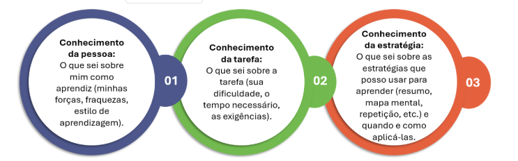
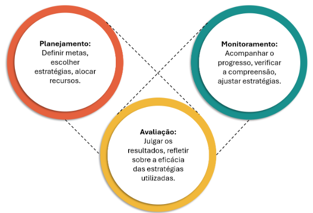
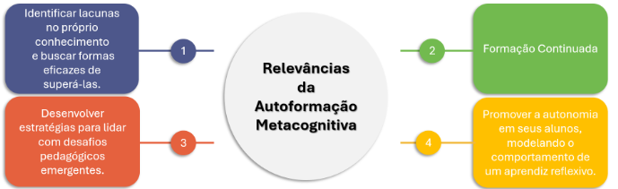
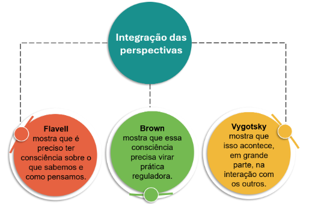

# METACOGNIÇÃO E DESENVOLVIMENTO DOCENTE

Introdução à metacognição: conceituação e relevância
A metacognição envolve o conhecimento e a regulação sobre os próprios processos de pensamento e aprendizagem, fortalecendo a autonomia docente, a reflexão crítica e o desenvolvimento profissional contínuo.

A metacognição pode ser compreendida como o conhecimento e a regulação sobre a própria cognição. Trata-se da capacidade de monitorar, planejar, controlar e avaliar nossos próprios processos de pensamento e aprendizagem. Não se limita apenas a “saber”, mas envolve “saber sobre o saber” e “saber como saber” (Flavell, 1979).

Conforme aponta Rodrigues (2023), a autoformação metacognitiva é essencial para a autonomia docente, pois nos possibilita transcender o papel de meros reprodutores de currículos, tornando-nos investigadores(as) ativos(as) de nossas próprias práticas e de nosso desenvolvimento profissional.

## Conhecimento metacognitivo

Refere-se ao que sabemos sobre a cognição.

Figura 1: Dimensões do Conhecimento Metacognitivo.

## Regulação metacognitiva

Refere-se às atividades que usamos para monitorar e controlar a cognição. Inclui:

Planejamento  Monitoramento  Avaliação

Figura 2: Ciclo Metacognitivo: Planejamento, Monitoramento e Avaliação.

## Importância para a aprendizagem ao longo da vida

Em um mundo em constante transformação, nossa capacidade de aprender de forma autônoma e eficaz torna-se mais valiosa do que o simples acúmulo de informações. A metacognição nos fortalece como aprendizes autodirigidos, capazes de nos adaptar a novos conhecimentos e contextos ao longo de toda a vida pessoal e profissional.

### Relevância para o desenvolvimento profissional docente

No campo da docência, a metacognição representa um diferencial formativo. Ela nos permite transformar experiências em aprendizagens significativas, tanto para nós mesmos(as) quanto para nossos(as) estudantes, promovendo uma prática cada vez mais reflexiva, consciente e intencional.

Figura 3: Contribuições da Metacognição para a Prática Docente.

# Teorias da aprendizagem e metacognição: um diálogo com grandes autores

Quando tratamos da metacognição, é fundamental lembrar que não estamos diante de uma ideia isolada, mas de um conceito que se entrelaça com diversas teorias da aprendizagem.

Para ampliarmos essa compreensão, dialogaremos com três autores cujas contribuições são fundamentais: Flavell, Brown e Vygotsky, que nos ajudam a compreender diferentes dimensões do pensar sobre o próprio pensar e nossa relação com o desenvolvimento humano e docente.

|John H. Flavell | Ann L. Brown | Lev S. Vygotsky |
|-- | -- | --|
| Ao buscarmos a origem da metacognição, encontramos em Flavell um ponto de partida essencial. Ele foi um dos primeiros a sistematizar a reflexão sobre como aprendemos. Em suas pesquisas, destacou duas dimensões principais: o conhecimento metacognitivo — saber o que sabemos, como aprendemos e quais estratégias utilizamos — e a regulação metacognitiva — a capacidade de planejar, monitorar e avaliar nossa própria aprendizagem. | Aprofundou as ideias de Flavell, trazendo a metacognição para o cotidiano da sala de aula. Defendeu que conhecer estratégias não basta — é preciso usá-las de forma consciente e ajustá-las conforme a necessidade. Ao destacar a autorregulação, mostrou que aprender envolve perceber, avaliar e adaptar o próprio modo de pensar, tornando a aprendizagem mais autônoma e significativa. | Nos oferecem uma terceira e poderosa lente para entender a metacognição, nos lembrando que a aprendizagem não acontece sozinha. Ela é um processo social, construído na interação com o outro. Ele não usou a palavra “metacognição”, mas suas ideias sobre a Zona de Desenvolvimento Proximal (ZDP) mostram que aprendemos mais e melhor quando interagimos com os outros. O que conseguimos fazer com ajuda hoje, conseguimos sozinhos amanhã. |

Nosso papel, enquanto educadores(as), é criar as condições para que esses momentos de colaboração floresçam, promovendo o diálogo, a escuta ativa e a ajuda mútua como parte natural do processo de aprender juntos(as).

Ao reunirmos as contribuições de Flavell, Brown e Vygotsky, temos um quadro completo da metacognição — uma visão que integra consciência individual, regulação estratégica e mediação social do conhecimento.

Figura 4: Integração das Perspectivas de Flavell, Brown e Vygotsky

Para nós, educadores(as), essa integração é essencial. Enquanto refletimos sobre nossa própria aprendizagem, também criamos oportunidades para que nossos estudantes aprendam a refletir, tanto de forma individual quanto em colaboração com os colegas.

Assim, refletir sozinhos é importante, mas não suficiente. A formação docente se fortalece quando o olhar do outro se encontra com o nosso, quando o “eu” se transforma em “nós”.

É nesse espaço colaborativo que a reflexão se aprofunda, a prática se consolida e a aprendizagem ganha significado coletivo, tanto para quem ensina quanto para quem aprende.